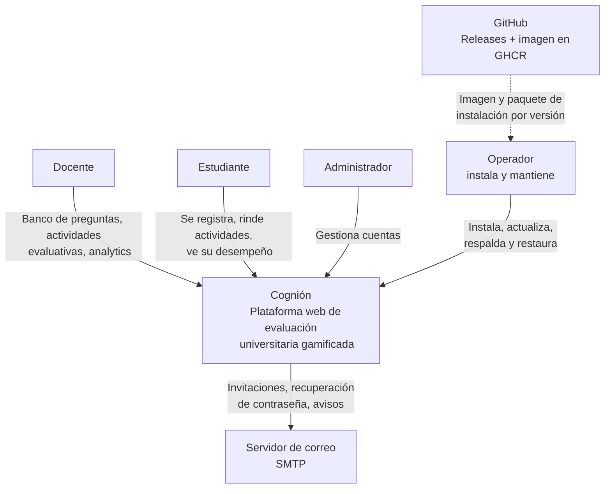

# 01 Contexto del sistema (C4 nivel 1)

> Vista corregida contra la versión `1.0.0` (Incremento 10.1, Fase 1). Plantilla: `_plantilla-vista.md`.

## Propósito

Responder qué es Cognión, quiénes lo usan, con qué sistemas externos se comunica y quién lo instala y lo opera. Es el límite del sistema y la puerta de entrada a las demás vistas.

## Interesados

- **Instalador:** ve qué actores y servicios externos exige la instalación.
- **Mantenedor:** ve el borde del sistema antes de bajar a contenedores y componentes.
- **Materia:** punto de partida para explicar el problema y los roles.

## Para leer esta vista

Cognión es una sola caja negra con tres roles de usuario, un operador y un servicio de correo. Todo lo que hay adentro se abre en `02-container-view.md`.

## Alcance

Incluye actores, sistema, sistemas externos y la entrega de cada versión. No incluye contenedores ni Bounded Contexts (`02` y `03`).

## Fuentes

- `docs/requirements/vision.md`, `docs/rf/RF_v1.md`, `docs/rf/RNF_v1.md`.
- `docs/adr/ADR-006`, `ADR-015`, `ADR-023` (SMTP por materia), `ADR-025`.
- `src/shared/entities/tipo_perfil.py` (roles), `src/settings.py` (correo, `ENTORNO`), `.github/workflows/cd.yml` (entrega de versiones), `docs/INSTALACION.md`.

## Descripción

Cognión es una plataforma web de evaluación universitaria con cuestionarios gamificados. Soporta dos modalidades de actividad evaluativa, **período abierto** y **en vivo** (estilo Kahoot!), sobre un banco de preguntas clasificado, con seguimiento del desempeño individual y por comisión.

El sistema es solo online y se usa desde el navegador. La actividad en vivo exige sincronización en tiempo real entre el docente y hasta 60 estudiantes conectados a la vez (RNF_v1).

## Actores

| Actor | Qué hace | Dónde se define |
|---|---|---|
| **Docente** | Arma el banco de preguntas, crea y conduce actividades en ambas modalidades, consulta analytics. Un docente puede estar asignado a varias comisiones y una comisión puede tener varios docentes (tabla `comision_docentes`). | `src/identidad/frameworks/db/models.py` |
| **Estudiante** | Se registra por link de invitación (individual o grupal), pertenece a una comisión, participa en las actividades y consulta su propio desempeño. | `docs/adr/ADR-012`, `ADR-027` |
| **Administrador** | Gestiona cuentas (bloqueos, recuperación, alta de docentes). El primero se crea al instalar. | `docs/adr/ADR-016` |
| **Operador** | Instala, actualiza, respalda y restaura. Suele ser la misma persona que el docente. No usa la aplicación: usa `scripts/local/` o `deploy/servidor/`. | `docs/INSTALACION.md` |

## Sistemas externos

| Sistema | Para qué | Cómo |
|---|---|---|
| **Servidor de correo (SMTP)** | Invitaciones, recuperación de contraseña y avisos de apertura y cierre de actividades. Con `EMAIL_MODO=consola` no se envía nada: el contenido queda en el log. | `smtplib` contra `SMTP_HOST`, con cuenta global o por materia (`ADR-023`) |
| **GitHub (Releases y GHCR)** | Entrega de cada versión: imagen `ghcr.io/vvalotto/cognion:vX.Y.Z` y paquete de instalación. Solo lo usa el operador al instalar o actualizar; el sistema en marcha no lo consulta. | `.github/workflows/cd.yml` |

## Diagrama

## Relaciones

| Relación | Descripción |
|---|---|
| Docente → Cognión | Banco de preguntas, creación y conducción de actividades, analytics. |
| Estudiante → Cognión | Registro por invitación, rendir actividades, consultar el propio desempeño. |
| Administrador → Cognión | Resolver problemas de cuentas. |
| Operador → Cognión | Instalación y operación fuera de la aplicación (scripts). |
| Cognión → SMTP | Correo transaccional. |
| GitHub → Operador | Descarga de la versión. No es una dependencia en tiempo de ejecución. |

## Decisiones reflejadas

`ADR-006` (notificación directa), `ADR-015` (Actividad Evaluativa), `ADR-023` (correo por materia), `ADR-025` (despliegue de prueba en GCP). El despliegue en servidor Linux con Docker no tiene ADR propio (ver `docs/plans/inc10-1/`).

## Restricciones y calidad

- Solo online, sin modo offline.
- La actividad en vivo exige sincronización en tiempo real con hasta 60 estudiantes.
- En `ENTORNO=staging` o `produccion` la aplicación no arranca con SMTP local ni `EMAIL_MODO=consola` (`src/settings.py`).
- La aplicación tiene un solo docente real en uso, pero el modelo no lo limita.

## Cómo verificar esta vista contra el código

- Roles: `src/shared/entities/tipo_perfil.py` y la tabla `comision_docentes` en `src/identidad/frameworks/db/models.py`.
- Correo: `src/settings.py` (`SMTP_*`, `smtp_cuentas_por_materia`, `EMAIL_MODO`) y los adaptadores `src/identidad/frameworks/smtp/` y `src/notificaciones/frameworks/adapters/`.
- Entrega: `.github/workflows/cd.yml` (job `release`).

## Cuándo hay que actualizarla

Un rol nuevo, un servicio externo nuevo (por ejemplo, un proveedor de correo que no sea SMTP) o un canal de entrega distinto de la versión.

## Sin verificar

- ⚠ La cuenta SMTP real que se usará en producción sigue sin decidirse (`CLAUDE.md`, ítems abiertos): hoy hay modo consola y envío por Gmail probado desde la Mac, no en un servidor de producción.
