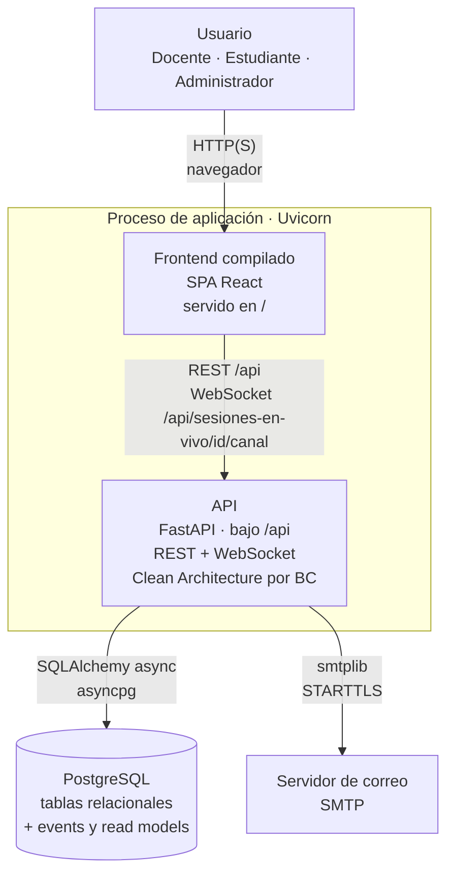
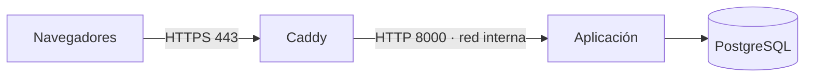

# 02 Contenedores (C4 nivel 2)

> Vista corregida contra la versión `1.0.0` (Incremento 10.1, Fase 1). Plantilla: `_plantilla-vista.md`.

## Propósito

Mostrar de qué procesos y almacenes se compone Cognión, con qué tecnología y cómo se comunican, y cómo cambia esa composición según la variante de instalación.

## Interesados

- **Instalador:** qué procesos hay que levantar en cada variante.
- **Mantenedor:** dónde corre cada pieza y por qué canal habla con las demás.
- **Materia:** un monolito modular desplegado como un solo proceso de aplicación.

## Para leer esta vista

Hay **un solo proceso de aplicación** que sirve la API y el frontend ya compilado. El navegador es el único otro "contenedor". Lo que cambia entre instalaciones es lo que rodea a ese proceso (proxy, base, contenedores).

## Alcance

Contenedores, tecnologías y relaciones de alto nivel. No incluye la estructura interna del backend (`03` y vistas de componentes) ni los pasos de instalación (`60-deployment-view.md`).

## Fuentes

- `docs/adr/ADR-001`, `002`, `003`, `004`, `005`, `018`.
- `src/servidor.py`, `src/app.py`, `Dockerfile`, `deploy/servidor/docker-compose.yml`, `deploy/servidor/Caddyfile`, `scripts/local/levantar.sh`.

## Descripción

Cognión es un **monolito modular** (`ADR-001`): un único proceso Python (Uvicorn) que ejecuta dos aplicaciones ASGI compuestas en `src/servidor.py`:

- la **API** (FastAPI, `src/app.py`), montada bajo `/api`: REST, el canal WebSocket de la sesión en vivo y las rutas de salud;
- el **frontend compilado**, montado en `/`: una SPA React que se sirve como archivos estáticos y devuelve `index.html` para las rutas de la aplicación.

La SPA y la API comparten origen, por eso el frontend llama a `/api` sin configuración de red. Los dos viajan en la misma imagen Docker (`Dockerfile`, dos etapas: compila la SPA con Node 22 y la copia al runtime de Python 3.12).

La persistencia es una **única instancia de PostgreSQL** (`ADR-004`) compartida por todos los Bounded Contexts. Con `NullPool` (`ADR-018`) cada operación abre su propia conexión, por eso se configura `max_connections=100`.

Un proceso dentro de la API, el `VerificadorDeVencimientos`, corre en el ciclo de vida de la aplicación (`lifespan`) y cierra las actividades de período abierto vencidas. No hay cola ni worker aparte.

## Contenedores

| Contenedor | Tecnología | Responsabilidad | Dónde está |
|---|---|---|---|
| **Navegador (SPA)** | React 19, TypeScript, Vite, Tailwind, shadcn/ui | Interfaz de los tres roles y proyección en el aula | `frontend/`, compilado a `frontend/dist` |
| **Aplicación** | Python 3.12, FastAPI, SQLAlchemy async, Uvicorn | API REST, canal WebSocket, casos de uso, composition root, estáticos del frontend, tarea de vencimientos | `src/` |
| **PostgreSQL** | PostgreSQL 14+ (16 en la composición Docker) | Tablas relacionales de Identidad y Banco de Preguntas; event store `events` (JSONB, solo se agrega) y read models de Actividad Evaluativa | `migrations/` |
| **Proxy inverso (según variante)** | Caddy 2 | HTTPS automático y paso de WebSockets hacia la aplicación | `deploy/servidor/Caddyfile`, `deploy/gcp/Caddyfile` |
| **Servidor de correo** | SMTP externo | Envío de correo | ver `01-system-context.md` |

Notificaciones y Analytics **no tienen almacenamiento propio**: Notificaciones es reactivo y Analytics proyecta a partir de los datos de otros contextos (`ADR-002`, `ADR-026`).

## Diagrama

La variante con servidor Linux agrega Caddy delante de la aplicación; la local no lo usa:

## Relaciones

| Relación | Mecanismo | Fuente |
|---|---|---|
| Navegador → Aplicación (REST) | HTTP(S) con JSON; JWT en `Authorization` | `src/app.py`, `ADR-007` |
| Navegador → Aplicación (tiempo real) | WebSocket en `/api/sesiones-en-vivo/{sesion_id}/canal?token=…` | `sesiones_en_vivo_router.py`, `ADR-005` |
| Aplicación → PostgreSQL | SQLAlchemy async con asyncpg, sin pool (`NullPool`) | `src/shared/frameworks/db.py`, `ADR-017`, `ADR-018` |
| Aplicación → SMTP | `smtplib` en hilo aparte; STARTTLS validado con `certifi` | `src/shared/frameworks/smtp.py` |
| Caddy → Aplicación | `reverse_proxy app:8000`; la app corre con `--proxy-headers` | `deploy/servidor/Caddyfile`, `Dockerfile` |

## Variantes de instalación

| Variante | Qué hay | Fuente |
|---|---|---|
| **Local, sin Docker** | Un proceso Uvicorn (con `caffeinate` en macOS) y un PostgreSQL local. Sin Caddy: se accede por HTTP en la red del aula. Base propia `cognion_local`. | `scripts/local/levantar.sh` |
| **Servidor Linux con Docker** | Tres contenedores: `db`, `app` (imagen de GHCR) y `caddy`. Solo Caddy publica puertos. | `deploy/servidor/docker-compose.yml` |
| **GCP (prueba)** | La misma composición en una VM, con dominio de DuckDNS. | `deploy/gcp/`, `ADR-025` |

## Decisiones reflejadas

`ADR-001` (monolito modular), `ADR-002` (event sourcing solo en Actividad Evaluativa), `ADR-003` (FastAPI), `ADR-004` (PostgreSQL), `ADR-005` (WebSocket), `ADR-017` y `ADR-018` (sesión y `NullPool`), `ADR-025` (GCP).

## Restricciones y calidad

- El frontend no accede a la base ni al correo: todo pasa por la API.
- El aislamiento entre Bounded Contexts es de código, no de infraestructura: comparten la misma base. Lo hace cumplir `import-linter` en el CI.
- Las conexiones WebSocket duran toda la actividad en vivo; una caída de la aplicación las corta (los clientes reconectan; ver `RNF_v1.md`, escenarios de continuidad).
- Sin un proceso aparte para tareas: reiniciar la aplicación reinicia también el verificador de vencimientos.

## Cómo verificar esta vista contra el código

- Composición: `src/servidor.py` (`mount("/api", api)`, `mount("/", …)`).
- Imagen: `Dockerfile` (etapas y `CMD`).
- Servicios y puertos: `deploy/servidor/docker-compose.yml`.
- Rutas de salud: `GET /api/health` y `GET /api/health/ready` (`src/shared/frameworks/salud.py`).

## Cuándo hay que actualizarla

Un contenedor nuevo (cola, worker, caché), un cambio de proxy o de base, la separación de la SPA en otro servicio o una variante de instalación nueva.

## Sin verificar

- ⚠ Las variantes con Docker (servidor Linux y GCP) no se probaron contra Docker real en esta versión; el compose se verificó con un `docker` simulado (Issue #624).
- ⚠ No se midió cuántas conexiones simultáneas alcanza la aplicación con 60 estudiantes; `max_connections=100` sale de la estimación de `docker-compose.yml`.
