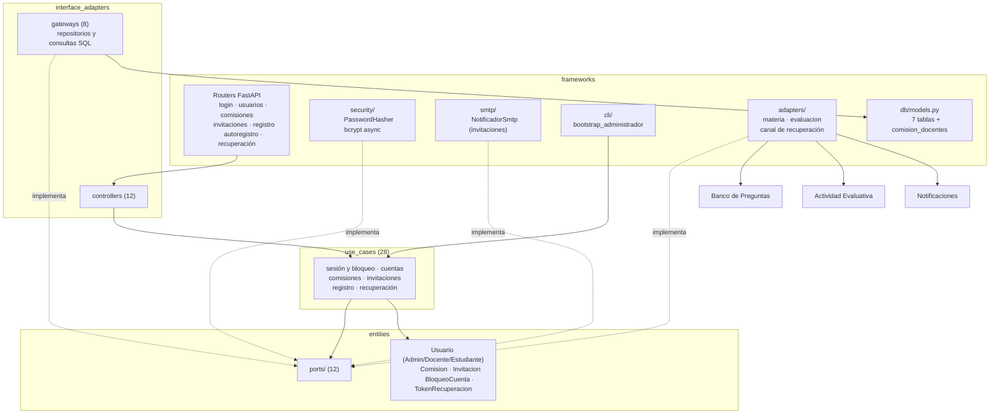

# 10 Componentes — Identidad (C4 nivel 3)

> Vista contrastada con el código de la versión `1.0.0` (Incremento 10.1, Fase 2). Plantilla: `_plantilla-vista.md`.

## Propósito
Mostrar cómo está armado por dentro el BC Identidad: cuentas, comisiones, invitaciones, autenticación y recuperación de contraseña.

## Interesados
**Mantenedor** (dónde tocar para cambiar una regla de cuentas o de acceso) y **materia** (ejemplo de un BC genérico con reglas de seguridad).

## Para leer esta vista
Identidad es el único BC que **autentica** y emite el JWT. Los demás BC no implementan autenticación: verifican el token con `shared/` (`ADR-019`) y consultan a Identidad por datos (comisiones, usuarios) con puertos propios. Es el BC con más casos de uso (28) y el que más proveedores y consumidores tiene.

## Alcance
Estructura interna, API pública y dependencias. El modelo de dominio con sus invariantes (`INV-ID-*`) está en `docs/design/domain/BC-identidad-modelo.md`; las tablas, en `24a-modelo-datos-identidad.md`.

## Fuentes
`src/identidad/`, `ADR-007`, `012`, `013`, `014`, `016`, `019`, `020`, `026`, `027`, `pyproject.toml` (`[tool.importlinter]`).

## Diagrama

## Elementos

| Capa | Elemento | Responsabilidad |
|---|---|---|
| entities | `Administrador`, `Docente`, `Estudiante` | Perfiles sobre `Usuario` (tabla `usuario` con tablas de perfil) |
| entities | `Comision` | Curso de una materia, con docentes asignados y estado activa o inactiva |
| entities | `Invitacion` | Link de registro: individual o **grupal** (vencimiento de 15 min, 1 h o 1 día, revocable, con contador de usos; `ADR-027`) |
| entities | `bloqueo_cuenta` | Bloqueo de la cuenta tras el 3.er fallo consecutivo: **permanente** (se levanta con el reseteo del administrador o al confirmar una recuperación de contraseña), salvo el último administrador operativo, que queda bloqueado solo 15 minutos por defecto para que el sistema no quede sin quien lo opere (`INV-ID-10`, `20`, `21`) |
| entities | `TokenRecuperacionPassword` | Recuperación por autoservicio |
| use_cases | `iniciar_sesion`, `politica_bloqueo` | Login, aviso "te queda 1 intento" y bloqueo |
| use_cases | `crear_usuario`, `listar_cuentas`, `obtener_cuenta`, `editar_cuenta`, `eliminar_cuenta`, `activar_cuenta`, `resetear_password`, `cambiar_password`, `bootstrap_administrador` | Cuentas y primer administrador |
| use_cases | `crear_comision`, `editar_comision`, `eliminar_comision`, `activar_comision`, `asignar_docente_a_comision`, `autorizacion_comision` | Comisiones y quién está asignado |
| use_cases | `generar_invitacion`, `generar_invitacion_grupal`, `obtener_invitacion`, `obtener_ultima_invitacion_grupal`, `revocar_invitacion_grupal`, `registrar_estudiante` | Invitaciones y registro |
| use_cases | `autoregistrar_docente`, `autoregistrar_estudiante`, `listar_materias_del_estudiante` | Autoservicio y portal de entrada |
| use_cases | `solicitar_recuperacion_password`, `confirmar_nueva_password` | Recuperación de contraseña |
| entities/ports | 12 puertos: repositorios (usuario, comisión, invitación, token), consultas (`ComisionQueryPort`, `CuentaQueryPort`, `NombreUsuarioQueryPort`), `PasswordHasherPort`, `NotificadorPort`, `CanalRecuperacionPort`, `MateriaPort`, `EvaluacionConsultaPort` | Contratos hacia persistencia, seguridad y otros BC |
| interface_adapters | 12 controllers y 8 gateways SQL | HTTP a casos de uso y repositorios SQLAlchemy |
| frameworks | `PasswordHasher` | bcrypt en un ejecutor propio, para no bloquear el event loop (`ADR-014`, `US-ADJ-63`) |
| frameworks | `NotificadorSmtp` | Correo de invitación, adaptador propio (`ADR-012`) |
| frameworks | CLI `bootstrap_administrador` | Primer administrador al instalar (`ADR-016`) |

## Rutas públicas
Bajo `/api`. "Autenticado" = cualquier usuario con token válido.

| Ruta | Quién |
|---|---|
| `POST /identidad/login` | Público |
| `GET /identidad/invitaciones/{token}`, `POST /identidad/registro` | Público (con token de invitación) |
| `POST /identidad/autoregistro/{docente,estudiante}`, `GET /identidad/autoregistro/materias[/{id}/comisiones]` | Público |
| `POST /identidad/recuperar-password/{solicitar,confirmar}` | Público |
| `PUT /usuarios/me/password` | Autenticado |
| `GET /identidad/estudiante/materias` | Estudiante |
| `POST /usuarios`; `GET/PATCH/DELETE /usuarios[/{id}]`; `POST /usuarios/{id}/{resetear-password,activar}` | Administrador |
| `POST/PATCH/DELETE /comisiones[/{id}]`, `POST /comisiones/{id}/{activar,docentes}` | Administrador |
| `GET /comisiones/{id}`, `GET /comisiones/{id}/estudiantes`, `GET /materias/{id}/comisiones` | Docente o administrador |
| `POST /comisiones/{id}/invitaciones` (individual) | Docente |
| `POST /comisiones/{id}/invitaciones-grupales`, `GET …/ultima`, `POST …/{id}/revocar` | Docente asignado a la comisión (si no, 403); el administrador no |

## Relaciones con otros BC
| Hacia | Qué | Mecanismo |
|---|---|---|
| Banco de Preguntas | Validar que una materia exista y su nombre | `MateriaPort` → caso de uso `ObtenerMateria` |
| Actividad Evaluativa | Saber qué evaluaciones tiene un estudiante (portal) | `EvaluacionConsultaPort` → consulta de solo lectura del proveedor |
| Notificaciones | Enviar el correo de recuperación | `CanalRecuperacionPort` → `SmtpCanalEnvio` |
| **Lo consumen** Banco, Actividad Evaluativa, Analytics y Notificaciones | Comisiones, asignación de docentes, usuarios y nombres | Gateways de consulta de este BC (`ComisionQueryPort`, `NombreUsuarioQueryPort`, `usuario_repository`) |

## Decisiones reflejadas
`ADR-007` (JWT y RBAC), `ADR-012` y `ADR-027` (invitaciones), `ADR-013` (sin refresh token), `ADR-014` (bcrypt), `ADR-016` (primer administrador), `ADR-019` (JWT y RBAC en `shared`), `ADR-020` (autoregistro), `ADR-026`.

## Restricciones y calidad
- **Seguridad:** el bloqueo limita los intentos de adivinar una contraseña. Un bloqueo temporal (último administrador) responde 403 con `codigo: cuenta_bloqueada_temporal` y los segundos que faltan. Hash bcrypt asíncrono.
- **Capas y aislamiento:** `import-linter` impide importar capas externas y a otros BC fuera de `frameworks/adapters/`. Excepción: los 8 gateways SQL importan `frameworks/db/models.py` de este mismo BC.
- Los tokens de invitación no se imprimen en el log de acceso (`US-ADJ-68`).

## Cómo verificar esta vista contra el código
- `ls src/identidad/{entities,entities/ports,use_cases,interface_adapters,frameworks}`.
- `grep -n "@router" src/identidad/frameworks/api/*_router.py`.
- `grep -n "^from src" src/identidad/frameworks/adapters/*.py` (cruces a otros BC) y `uv run lint-imports`.

## Cuándo hay que actualizarla
Un caso de uso, ruta o puerto nuevo; un cambio de rol exigido; una regla de bloqueo; o un cruce nuevo con otro BC.

## Sin verificar
- ⚠ El valor por defecto del bloqueo temporal es de 15 minutos (`iniciar_sesion.py`); el configurado en una instalación puede diferir.
- ⚠ El detalle de las invariantes `INV-ID-*` no se contrastó aquí: auditoría de `docs/design/domain/` en la Fase 3.
