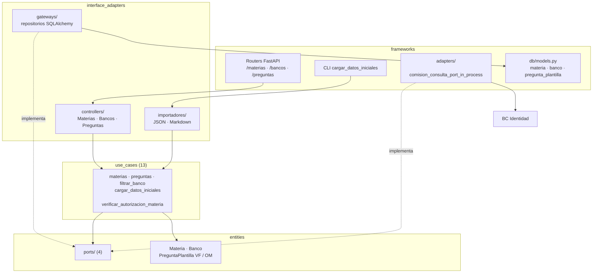

# 11 Componentes — Banco de Preguntas (C4 nivel 3)

> Vista contrastada con el código de la versión `1.0.0` (Incremento 10.1, Fase 2). Plantilla: `_plantilla-vista.md`.

## Propósito
Mostrar cómo está armado por dentro el BC Banco de Preguntas: capas, casos de uso, puertos, adaptadores y rutas.

## Interesados
**Mantenedor** (dónde tocar para cambiar una regla del banco) y **materia** (ejemplo de un BC de apoyo con Clean Architecture).

## Para leer esta vista
El BC guarda `Materia`, `Banco` (uno por materia) y `PreguntaPlantilla` (de dos tipos). Los casos de uso hablan con puertos; las implementaciones están en `interface_adapters/gateways/` (SQL) y `frameworks/adapters/` (otro BC). Para el modelo de dominio y sus invariantes ver `docs/design/domain/BC-banco-preguntas-modelo.md`.

## Alcance
Estructura interna, API pública y dependencias. No repite el modelo de dominio ni el esquema de tablas (`24b-modelo-datos-banco-preguntas.md`).

## Fuentes
`src/banco_preguntas/`, `ADR-001`, `ADR-026`, `pyproject.toml` (`[tool.importlinter]`), `docs/design/domain/BC-banco-preguntas-modelo.md`.

## Diagrama

## Elementos

| Capa | Elemento | Responsabilidad | Archivo |
|---|---|---|---|
| entities | `Materia`, `Banco`, `PreguntaPlantillaVerdaderoFalso`, `PreguntaPlantillaOpcionMultiple`, `Opcion`, `Dificultad`, `Importancia`, `MetadatosPregunta` | Reglas del banco; un banco por materia | `entities/` |
| entities | Eventos de dominio (`MateriaCreada`, `BancoCreado`, `PreguntaCargada`, `PreguntaEditada`, `PreguntaEliminada`) | Registro de lo ocurrido | `entities/eventos.py` |
| entities/ports | `MateriaRepositoryPort`, `BancoRepositoryPort`, `PreguntaRepositoryPort`, `ComisionConsultaPort` | Contratos hacia persistencia y hacia Identidad | `entities/ports/` |
| use_cases | `crear_materia`, `editar_materia`, `eliminar_materia`, `activar_materia`, `listar_materias`, `obtener_materia` | Ciclo de vida de la materia | `use_cases/` |
| use_cases | `cargar_pregunta_opcion_multiple`, `cargar_pregunta_verdadero_falso`, `editar_pregunta`, `eliminar_pregunta`, `filtrar_banco` | Preguntas y consulta con filtros | `use_cases/` |
| use_cases | `verificar_autorizacion_materia` | El docente debe estar asignado a la materia | `use_cases/` |
| use_cases | `cargar_datos_iniciales` | Alta masiva idempotente desde JSON o Markdown | `use_cases/` |
| interface_adapters | `MateriasController`, `BancosController`, `PreguntasController` | Traducen HTTP a casos de uso | `controllers/` |
| interface_adapters | `materia_repository`, `banco_repository`, `pregunta_repository` | Repositorios SQLAlchemy | `gateways/` |
| interface_adapters | `json_importador`, `markdown_importador` | Lectura de los archivos de carga | `importadores/` |
| frameworks | Routers, esquemas Pydantic, `dependencies.py` (composition root) | Frontera HTTP y cableado | `frameworks/api/` |
| frameworks | `comision_consulta_port_in_process` | Pregunta a Identidad si la materia tiene comisiones y si un docente está asignado | `frameworks/adapters/` |
| frameworks | `cargar_datos_iniciales` (CLI) | Comando de operación (`US-8.7.1`) | `frameworks/cli/` |

## Rutas públicas
Todas bajo `/api`.

| Ruta | Rol exigido |
|---|---|
| `POST /materias`, `PATCH /materias/{id}`, `DELETE /materias/{id}`, `POST /materias/{id}/activar` | Administrador |
| `GET /materias` | Docente o administrador |
| `GET /bancos/{banco_id}/preguntas` | Docente |
| `POST /preguntas/opcion-multiple`, `POST /preguntas/verdadero-falso`, `PUT /preguntas/{id}`, `DELETE /preguntas/{id}` | Docente |

## Relaciones con otros BC
| Hacia | Qué | Mecanismo |
|---|---|---|
| Identidad | Saber si una materia tiene comisiones (impide borrarla) y si un docente está asignado a la materia | `ComisionConsultaPort`, adaptador en `frameworks/adapters/` |
| Actividad Evaluativa | Provee el catálogo de preguntas | Actividad Evaluativa consulta por su propio puerto; este BC no lo conoce |
| Analytics | Sus metadatos de pregunta (tema, dificultad) se leen para la tasa de error | Analytics lee `PreguntaPlantillaModel` (excepción de `ADR-026`) |

## Decisiones reflejadas
`ADR-001` (Clean Architecture por BC), `ADR-006` y `ADR-026` (comunicación entre BC), `ADR-015` (nombres).

## Restricciones y calidad
- Los contratos de `import-linter` fallan el CI si una capa interna importa una externa, o si este BC importa a otro fuera de `frameworks/adapters/`.
- Excepción declarada: los repositorios de `gateways/` importan `frameworks/db/models.py`.
- Ningún BC distinto de Analytics lee los modelos ORM de este (`ADR-026`).

## Cómo verificar esta vista contra el código
- Estructura: `ls src/banco_preguntas/{entities,entities/ports,use_cases,interface_adapters,frameworks}`.
- Rutas: `grep -n "@router" src/banco_preguntas/frameworks/api/*_router.py`.
- Reglas de capas: `uv run lint-imports`.

## Cuándo hay que actualizarla
Un caso de uso, puerto, ruta o tipo de pregunta nuevo; un cambio de rol exigido; o una relación nueva con otro BC.

## Sin verificar
- ⚠ El detalle de invariantes de cada pregunta no se contrastó aquí: lo cubre `docs/design/domain/BC-banco-preguntas-modelo.md` (auditoría en la Fase 3).
