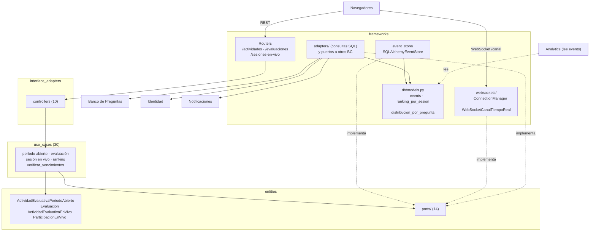

# 12 Componentes — Actividad Evaluativa (C4 nivel 3)

> Vista contrastada con el código de la versión `1.0.0` (Incremento 10.1, Fase 2). Plantilla: `_plantilla-vista.md`.

## Propósito
Mostrar cómo está armado por dentro el BC central de Cognión: el ciclo de vida de las actividades evaluativas, el event store y el tiempo real.

## Interesados
**Mantenedor** (dónde tocar una regla de la actividad, el ranking o el canal en vivo) y **materia** (ejemplo de Event Sourcing con CQRS en un monolito modular).

## Para leer esta vista
Es el **Core Domain**. Sus agregados no se guardan como filas: se reconstruyen desde **eventos** en una tabla `events` que solo se agrega (`ADR-002`). Para consultas rápidas hay **read models** (`ranking_por_sesion`, `distribucion_por_pregunta`) que se actualizan en la misma transacción que el evento. Hay dos modalidades: **período abierto** y **en vivo**.

## Alcance
Estructura interna, API pública, event store y tiempo real. El modelo de dominio (eventos, invariantes, secuencias) está en `docs/design/domain/BC-actividad-evaluativa-modelo.md`; las tablas, en `24c-modelo-datos-actividad-evaluativa.md`.

## Fuentes
`src/actividad_evaluativa/`, `ADR-002`, `005`, `006`, `015`, `026`, `pyproject.toml` (`[tool.importlinter]`), `docs/design/domain/BC-actividad-evaluativa-modelo.md`.

## Diagrama

## Elementos

| Capa | Elemento | Responsabilidad |
|---|---|---|
| entities | `ActividadEvaluativaPeriodoAbierto` | Actividad con apertura y cierre; se puede modificar el período y el título, y cerrar |
| entities | `Evaluacion` (+ `PreguntaAsignada`, `RevisionEvaluacion`) | Intento de un estudiante: iniciar, responder, suspender, reanudar, finalizar y revisar |
| entities | `ActividadEvaluativaEnVivo`, `ParticipacionEnVivo`, `puntaje_en_vivo` | Sesión conducida por el docente, participantes, respuestas y puntaje (RF-10) |
| entities | `eventos`, `eventos_en_vivo` | Eventos de dominio de ambas modalidades |
| entities/ports | `EventStorePort`, `ProyeccionesEnVivoPort`, `CanalTiempoRealPort` | Event store, read models del ranking y difusión |
| entities/ports | `MateriaConsultaPort`, `PreguntaConsultaPort`, `ComisionConsultaPort`, `EstudianteConsultaPort`, `NotificacionPort` | Cruces hacia Banco, Identidad y Notificaciones |
| entities/ports | `ActividadQueryPort`, `EvaluacionActivaQueryPort`, `EvaluacionEstudianteQueryPort`, `EstudianteEvaluacionesQueryPort`, `ParticipantesSesionQueryPort`, `SesionesEnVivoQueryPort` | Consultas de solo lectura (CQRS) |
| use_cases | `crear_actividad_periodo_abierto`, `modificar_periodo_disponibilidad`, `modificar_titulo_actividad`, `cerrar_actividad`, `listar_actividades[_visibles]`, `obtener_actividad` | Actividades de período abierto |
| use_cases | `iniciar_evaluacion`, `registrar_respuesta`, `suspender_evaluacion`, `reanudar_evaluacion`, `finalizar_evaluacion`, `obtener_revision_evaluacion` | Intento del estudiante |
| use_cases | `crear_sesion_en_vivo`, `iniciar_sesion_en_vivo`, `unirse_a_sesion_en_vivo`, `mostrar_opciones_en_vivo`, `responder_pregunta_en_vivo`, `cerrar_pregunta_actual`, `avanzar_siguiente_pregunta`, `finalizar_sesion_en_vivo`, `cancelar_sesion_en_vivo`, `obtener_ranking`, `obtener_estado_sesion`, `listar_participantes`, `listar_sesiones_en_vivo` | Sesión en vivo |
| use_cases | `verificar_vencimientos`, `verificar_autorizacion_comision` | Cierre automático por vencimiento; el docente debe estar asignado |
| interface_adapters | 10 controllers | HTTP a casos de uso |
| frameworks | `SQLAlchemyEventStore` | Guarda y lee eventos de la tabla `events` |
| frameworks | `ConnectionManager`, `WebSocketCanalTiempoReal` | Difusión por sesión a los navegadores conectados |
| frameworks | 12 adaptadores | 7 consultas y proyecciones propias (`*_repository`) y 5 cruces con otros BC (`*_port_in_process`: comisión, estudiante, materia, pregunta y notificación) |

## Rutas públicas
Bajo `/api`.

| Ruta | Rol |
|---|---|
| `GET /actividades`, `GET /actividades/{id}`, `POST /actividades`, `PATCH /actividades/{id}/{periodo,titulo}`, `POST /actividades/{id}/cerrar` | Docente |
| `GET /actividades/mis-actividades` | Estudiante |
| `POST /evaluaciones`, `POST /evaluaciones/{id}/{respuestas,suspender,reanudar,finalizar}` | Estudiante |
| `GET /evaluaciones/{id}/revision` | Estudiante o docente |
| `POST /sesiones-en-vivo`, `…/{id}/{iniciar,cancelar,mostrar-opciones,cerrar-pregunta,avanzar,finalizar}`, `GET …/{id}/participantes` | Docente |
| `POST /sesiones-en-vivo/{id}/{unirse,responder}` | Estudiante |
| `GET /sesiones-en-vivo`, `GET …/{id}`, `GET …/{id}/ranking` | Estudiante o docente |
| `WebSocket /sesiones-en-vivo/{id}/canal?token=…` | Cualquier usuario con JWT válido; sin chequeo de rol (docente y estudiante comparten el canal de lectura) |

## Relaciones con otros BC
| Hacia | Qué | Mecanismo |
|---|---|---|
| Banco de Preguntas | Materia y preguntas para armar una actividad | `MateriaConsultaPort`, `PreguntaConsultaPort` |
| Identidad | Comisiones, asignación de docentes, estudiantes y nombres | `ComisionConsultaPort`, `EstudianteConsultaPort` |
| Notificaciones | Aviso al abrir y cerrar una actividad de período abierto | `NotificacionPort` → casos de uso de Notificaciones (`ADR-006`) |
| **Lo consumen** Analytics e Identidad | Analytics lee `events` y `ranking_por_sesion` (`ADR-026`); Identidad consulta evaluaciones por estudiante | Modelos ORM / consulta de solo lectura de este BC |

## Decisiones reflejadas
`ADR-002` (event sourcing y CQRS), `ADR-005` (WebSocket), `ADR-006` (notificación directa), `ADR-015` (nombre del BC), `ADR-026`.

## Restricciones y calidad
- **Tiempo real:** el ranking se actualiza al responder (read model síncrono), sin esperar el cierre de la pregunta; la difusión por WebSocket es en proceso, sin broker.
- **Vencimientos:** el `VerificadorDeVencimientos` corre en el ciclo de vida de la aplicación (`src/servidor.py`) con una cadencia configurable (`verificador_vencimientos_cadencia_segundos`); aplica dos reglas con actor `sistema`: suspende las evaluaciones inactivas (regla 1) y finaliza las que superaron el vencimiento del período (regla 2). Reutiliza `SuspenderEvaluacion` y `FinalizarEvaluacion`.
- **Capas y aislamiento:** los cruces a otros BC viven solo en `frameworks/adapters/` (`import-linter`).
- **Continuidad:** reiniciar el proceso corta los WebSockets; el cliente reconecta y consulta el estado por HTTP (`RNF_v1.md`, continuidad).

## Cómo verificar esta vista contra el código
- `ls src/actividad_evaluativa/{entities,entities/ports,use_cases,interface_adapters/controllers,frameworks/adapters}`.
- `grep -n "@router" src/actividad_evaluativa/frameworks/api/*_router.py`.
- `grep -n "^from src" src/actividad_evaluativa/frameworks/adapters/*.py` y `uv run lint-imports`.

## Cuándo hay que actualizarla
Un agregado, evento, caso de uso, ruta o puerto nuevo; cambios en el event store o en los read models; o un cruce nuevo con otro BC.

## Sin verificar
- ⚠ El cierre de pregunta con 60 conexiones simuladas cumplió el criterio de 100 ms (p95 de 79 ms, `US-6.2.9`), pero en una Mac, no en un servidor ni con navegadores reales conectados.
- ⚠ El modelo de dominio y el diagrama de estados de la sesión en vivo no se contrastaron: auditoría de `docs/design/domain/` en la Fase 3.
