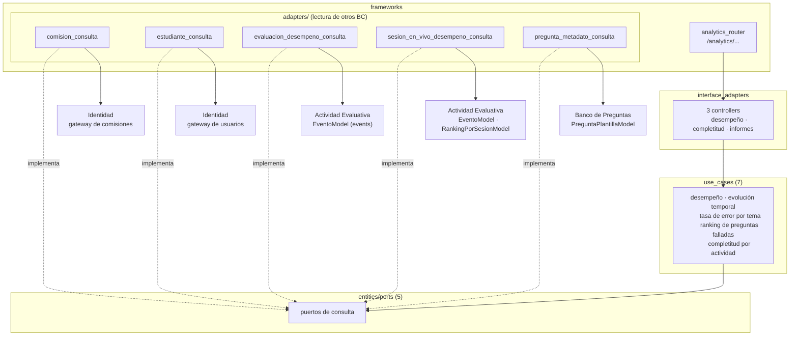

# 13 Componentes — Analytics (C4 nivel 3)

> Vista contrastada con el código de la versión `1.0.0` (Incremento 10.1, Fase 2). Plantilla: `_plantilla-vista.md`.

## Propósito
Mostrar cómo Analytics calcula el desempeño a partir de datos de otros BC sin tener estado propio.

## Interesados
**Mantenedor** (dónde agregar una métrica) y **materia** (ejemplo de un BC de solo lectura y de la excepción de `ADR-026`).

## Para leer esta vista
Analytics **no tiene tablas ni lógica de negocio de escritura**. Cada caso de uso es una consulta que arma un resultado desde un puerto; cada puerto lo implementa un adaptador en `frameworks/adapters/` que lee datos de otro BC. Es el único BC al que `ADR-026` autoriza a leer modelos ORM ajenos.

## Alcance
Estructura interna, API pública y de dónde sale cada dato. El modelo de dominio de las proyecciones está en `docs/design/domain/BC-analytics-modelo.md`.

## Fuentes
`src/analytics/`, `ADR-002`, `ADR-026`, `pyproject.toml` (`[tool.importlinter]`), `docs/design/domain/BC-analytics-modelo.md`.

## Diagrama

## Elementos

| Capa | Elemento | Responsabilidad |
|---|---|---|
| use_cases | `obtener_desempeno_estudiante`, `obtener_desempeno_por_comision` | Desempeño individual y por comisión |
| use_cases | `obtener_evolucion_temporal_estudiante`, `obtener_evolucion_temporal_comision` | Evolución en el tiempo |
| use_cases | `obtener_tasa_error_por_tema`, `obtener_ranking_preguntas_falladas` | Informes de la materia |
| use_cases | `obtener_completitud_por_actividad` | Quién completó una actividad |
| entities/ports | `ComisionConsultaPort`, `EstudianteConsultaPort`, `EvaluacionDesempenoConsultaPort`, `SesionEnVivoDesempenoConsultaPort`, `PreguntaMetadatoConsultaPort` | Contratos de lectura (resúmenes como `dataclass`) |
| interface_adapters | `analytics_controller`, `analytics_informes_controller`, `analytics_completitud_controller` | HTTP a casos de uso |
| frameworks | Router, esquemas, `dependencies.py` | Frontera HTTP y cableado |

## De dónde sale cada dato
| Puerto | Adaptador lee | Cómo |
|---|---|---|
| `ComisionConsultaPort` | Comisiones, estudiantes y asignación de docentes | Gateway de Identidad (`comision_query_repository`) |
| `EstudianteConsultaPort` | Existencia de un estudiante | Gateway de Identidad (`usuario_repository`) |
| `EvaluacionDesempenoConsultaPort` | Evaluaciones y respuestas de período abierto | `EventoModel` (event store de Actividad Evaluativa) más sus entidades |
| `SesionEnVivoDesempenoConsultaPort` | Sesiones en vivo finalizadas | `EventoModel` y `RankingPorSesionModel` |
| `PreguntaMetadatoConsultaPort` | Tema, dificultad e importancia de cada pregunta | `PreguntaPlantillaModel` de Banco de Preguntas |

La lectura de modelos ORM ajenos (`EventoModel`, `RankingPorSesionModel`, `PreguntaPlantillaModel`) es la excepción que `ADR-026` concede solo a Analytics, solo en adaptadores de lectura.

## Rutas públicas
Todas `GET`, bajo `/api`. `mi-desempeno` exige rol **estudiante** (cada uno ve el propio); las demás exigen rol **docente**.

| Ruta |
|---|
| `/analytics/materias/{materia_id}/mi-desempeno` |
| `/analytics/materias/{materia_id}/estudiantes/{estudiante_id}/desempeno` |
| `/analytics/materias/{materia_id}/comisiones/{comision_id}/desempeno` |
| `/analytics/materias/{materia_id}/estudiantes/{estudiante_id}/evolucion-temporal` |
| `/analytics/materias/{materia_id}/comisiones/{comision_id}/evolucion-temporal` |
| `/analytics/materias/{materia_id}/tasa-error-por-tema` |
| `/analytics/materias/{materia_id}/ranking-preguntas-falladas` |
| `/analytics/actividades/{actividad_id}/completitud` |

## Decisiones reflejadas
`ADR-002` (event sourcing y proyecciones), `ADR-026` (excepción de lectura de Analytics), `ADR-001`.

## Restricciones y calidad
- No modifica el estado de ningún BC: solo lee.
- `import-linter` impide que cualquier BC distinto de Analytics lea los modelos ORM de otro.
- Las consultas se calculan al pedirlas (no hay caché ni tablas de resumen propias).

## Cómo verificar esta vista contra el código
- `grep -n "@router" src/analytics/frameworks/api/analytics_router.py`.
- `grep -n "^from src" src/analytics/frameworks/adapters/*.py` (de dónde lee cada adaptador).
- `uv run lint-imports`.

## Cuándo hay que actualizarla
Una métrica nueva (caso de uso, ruta o puerto), un adaptador que lea otro modelo ORM, o un cambio de `ADR-026`.

## Sin verificar
- ⚠ Rendimiento con volúmenes grandes de eventos: no se midió.
