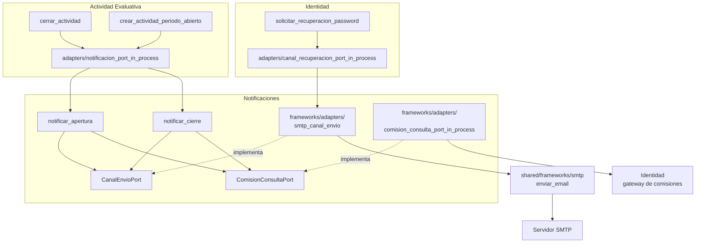

# 14 Componentes — Notificaciones (C4 nivel 3)

> Vista contrastada con el código de la versión `1.0.0` (Incremento 10.1, Fase 2). Plantilla: `_plantilla-vista.md`.

## Propósito
Mostrar el BC más chico: un envío de correo reactivo, sin estado ni API propia.

## Interesados
**Mantenedor** (cómo se envía un aviso y cómo cambiar de canal) y **materia** (ejemplo de BC reactivo y de comunicación entre BC por puertos).

## Para leer esta vista
Notificaciones **no expone rutas, no tiene tablas ni capa `interface_adapters`**. Otros BC lo invocan en proceso: Actividad Evaluativa lo llama al abrir y cerrar una actividad de período abierto, e Identidad reutiliza su canal SMTP para la recuperación de contraseña.

## Alcance
Estructura interna y quién lo invoca. El modelo de dominio está en `docs/design/domain/BC-notificaciones-modelo.md`.

## Fuentes
`src/notificaciones/`, `src/actividad_evaluativa/frameworks/adapters/notificacion_port_in_process.py`, `src/identidad/frameworks/adapters/canal_recuperacion_port_in_process.py`, `src/shared/frameworks/smtp.py`, `docs/adr/ADR-006`, `ADR-023`.

## Diagrama

## Elementos

| Capa | Elemento | Responsabilidad | Archivo |
|---|---|---|---|
| use_cases | `NotificarAperturaUseCase`, `NotificarCierreUseCase` | Armar y enviar el aviso a los destinatarios de las comisiones de la materia | `use_cases/` |
| entities/ports | `CanalEnvioPort` | Enviar un mensaje por un canal | `entities/ports/canal_envio_port.py` |
| entities/ports | `ComisionConsultaPort` (+ `DestinatarioNotificacion`) | Listar comisiones y destinatarios de una materia | `entities/ports/comision_consulta_port.py` |
| frameworks | `SmtpCanalEnvio` | Implementa el canal con `smtplib` (cuenta global o por materia, `ADR-023`) | `frameworks/adapters/smtp_canal_envio.py` |
| frameworks | `comision_consulta_port_in_process` | Lee comisiones y estudiantes del gateway de Identidad | `frameworks/adapters/` |

## Relaciones
| Quién | Cómo lo usa |
|---|---|
| Actividad Evaluativa | Su caso de uso llama a `NotificacionPort`; el adaptador instancia los casos de uso de este BC (`ADR-006`, relación *Conformist*) |
| Identidad | Su adaptador `canal_recuperacion_port_in_process` (implementa `CanalRecuperacionPort`, `US-ADJ-38`) instancia directamente `SmtpCanalEnvio`; no usa los casos de uso de este BC |
| Servidor SMTP | `smtplib` desde `src/shared/frameworks/smtp.py`; con `EMAIL_MODO=consola` no se envía y el cuerpo queda en el log |

El correo de invitación de Identidad **no pasa por este BC**: usa su propio adaptador (`src/identidad/frameworks/smtp/`).

## Decisiones reflejadas
`ADR-006` (llamada directa Actividad Evaluativa → Notificaciones), `ADR-023` (cuenta SMTP por materia), `ADR-012`.

## Restricciones y calidad
- Un fallo de envío **no interrumpe** la apertura ni el cierre: cada destinatario se envía dentro de su propio `try/except`, el error se registra en el log (`warning` con el destinatario) y se sigue con el siguiente (`notificar_apertura.py`, `notificar_cierre.py`). No hay reintentos ni cola.
- En `ENTORNO=staging` o `produccion` la aplicación no arranca con SMTP local ni con `EMAIL_MODO=consola`.

## Cómo verificar esta vista contra el código
- `ls src/notificaciones/{entities/ports,use_cases,frameworks/adapters}`.
- `grep -rn "notificar_apertura\|notificar_cierre" src --include='*.py'`.
- `uv run lint-imports`.

## Cuándo hay que actualizarla
Un canal nuevo (otro además del correo), un tipo de aviso nuevo o un BC nuevo que lo invoque.

## Sin verificar
- ⚠ Un destinatario que falla no se reintenta ni queda registrado fuera del log: no hay forma de saber luego a quién no le llegó el aviso.
- ⚠ Hay dos adaptadores SMTP separados (este y el de Identidad): deuda técnica consciente heredada, no se unificó.
