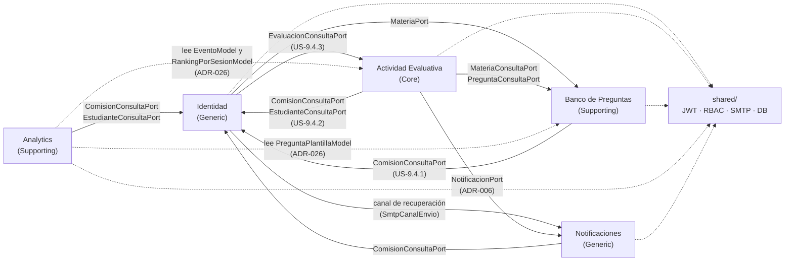

# 20 Mapa de contexto — integraciones entre Bounded Contexts

> Vista contrastada con el código de la versión `1.0.0` (Incremento 10.1, Fase 2). Plantilla: `_plantilla-vista.md`. Reemplaza a la v0 del 2026-09-29.

## Propósito
Documentar cómo colaboran los cinco BC en tiempo de ejecución: quién depende de quién, por qué puerto y con qué patrón de *context mapping* de DDD.

## Interesados
**Mantenedor** (antes de agregar un cruce entre BC) y **materia** (ejemplo real de context map con reglas verificadas por herramienta).

## Para leer esta vista
Todo cruce entre BC vive en un **adaptador** de `src/<bc_consumidor>/frameworks/adapters/`. Es lo único que `import-linter` permite importar de otro BC. Cada fila de la tabla es un adaptador real; la columna "Cómo lee" dice si usa un caso de uso, un gateway (repositorio) del proveedor o, solo en Analytics, el modelo ORM.

## Alcance
Relaciones entre BC. La estructura interna de cada uno está en `10` a `14-componentes-*.md`.

## Fuentes
`src/*/frameworks/adapters/`, `pyproject.toml` (`[tool.importlinter]`), `docs/adr/ADR-002`, `006`, `012`, `019`, `026`, `027`.

## Diagrama

Línea punteada con texto: lectura de un modelo ORM ajeno (solo Analytics) o de `shared/`.

## Relaciones (una fila por adaptador)

| Consumidor | Proveedor | Puerto del consumidor | Cómo lee | Patrón | Adaptador |
|---|---|---|---|---|---|
| Identidad | Banco de Preguntas | `MateriaPort` | Caso de uso `ObtenerMateria` y gateway de materias | Customer-Supplier | `identidad/…/materia_port_in_process.py` |
| Identidad | Actividad Evaluativa | `EvaluacionConsultaPort` | Consulta de solo lectura `EstudianteEvaluacionesQueryPort` | Customer-Supplier | `identidad/…/evaluacion_consulta_port_in_process.py` |
| Identidad | Notificaciones | `CanalRecuperacionPort` | Instancia `SmtpCanalEnvio` | Conformist | `identidad/…/canal_recuperacion_port_in_process.py` |
| Banco | Identidad | `ComisionConsultaPort` | Gateway de consultas de comisiones (`tiene_comisiones`, `esta_asignado_a_materia`) | Customer-Supplier | `banco_preguntas/…/comision_consulta_port_in_process.py` |
| Actividad Evaluativa | Banco | `MateriaConsultaPort`, `PreguntaConsultaPort` | Caso de uso `ObtenerMateria` y gateways de banco y preguntas | Customer-Supplier | `actividad_evaluativa/…/materia_consulta_…`, `pregunta_consulta_…` |
| Actividad Evaluativa | Identidad | `ComisionConsultaPort`, `EstudianteConsultaPort` | Gateways de comisiones, usuarios y `NombreUsuarioQueryPort` | Customer-Supplier | `actividad_evaluativa/…/comision_consulta_…`, `estudiante_consulta_…` |
| Actividad Evaluativa | Notificaciones | `NotificacionPort` | Instancia los casos de uso `NotificarApertura` y `NotificarCierre` | Conformist (`ADR-006`) | `actividad_evaluativa/…/notificacion_port_in_process.py` |
| Analytics | Identidad | `ComisionConsultaPort`, `EstudianteConsultaPort` | Gateways de comisiones y usuarios | Customer-Supplier | `analytics/…/comision_consulta_…`, `estudiante_consulta_…` |
| Analytics | Actividad Evaluativa | `EvaluacionDesempenoConsultaPort`, `SesionEnVivoDesempenoConsultaPort` | **Modelo ORM** `EventoModel`, `RankingPorSesionModel` | Customer-Supplier por datos (`ADR-002`, `ADR-026`) | `analytics/…/evaluacion_desempeno_…`, `sesion_en_vivo_desempeno_…` |
| Analytics | Banco | `PreguntaMetadatoConsultaPort` | **Modelo ORM** `PreguntaPlantillaModel` | Customer-Supplier por datos (`ADR-026`) | `analytics/…/pregunta_metadato_…` |
| Notificaciones | Identidad | `ComisionConsultaPort` | Gateway de comisiones (destinatarios) | Customer-Supplier | `notificaciones/…/comision_consulta_port_in_process.py` |

**Transversal (`shared/`, `ADR-019`):** la validación del JWT y los roles, el acceso a base y el envío SMTP viven en `src/shared/` y no son una relación entre BC. Identidad emite el token; el resto solo lo verifica con `shared`.

Sin servicio externo aparte del SMTP: el correo de invitación de Identidad usa su propio adaptador (`src/identidad/frameworks/smtp/`), independiente de Notificaciones.

## Qué impone el CI
`import-linter` (`uv run lint-imports`, 4 contratos en `pyproject.toml`):
1. **Capas dentro de cada BC:** `frameworks → interface_adapters → use_cases → entities`. Excepción: los repositorios de `gateways/` importan `frameworks/db/models.py` (9 archivos de Identidad y Banco).
2. **Aislamiento entre BC:** solo `frameworks/adapters/` puede importar de otro BC (`ADR-006`).
3. **`shared` no importa de ningún BC.**
4. **`ADR-026`:** ningún BC salvo Analytics importa los modelos ORM de otro. Desde el Incremento 9 (`BL-015`) no queda ninguna excepción puntual.

## Decisiones reflejadas
`ADR-002`, `ADR-006` (llamada directa a Notificaciones), `ADR-012` y `ADR-027` (invitación), `ADR-019` (JWT y RBAC en `shared`), `ADR-026` (acoplamiento por datos).

## Restricciones y calidad
- Los BC comparten una sola base (`02-container-view.md`): el aislamiento es de código, no de infraestructura.
- La dirección de dependencia de **Actividad Evaluativa → Identidad** y de **Identidad → Actividad Evaluativa** coexisten (mediante puertos distintos): no hay ciclo de imports porque cada cruce va por un adaptador.

## Cómo verificar esta vista contra el código
- `grep -n "^from src" src/*/frameworks/adapters/*.py` (qué importa cada adaptador de otro BC).
- `uv run lint-imports` y `tests/unit/inc9/test_guarda_arquitectura.py`.

## Cuándo hay que actualizarla
Un adaptador nuevo o un puerto nuevo entre BC, una excepción nueva de `ADR-026`, o un cambio en los contratos de `pyproject.toml`.

## Sin verificar
- ⚠ Los adaptadores de Actividad Evaluativa que no cruzan a otro BC (`*_query_repository.py`) sirven consultas de su propio BC a otros; no se listaron como relaciones propias.
- ⚠ Un comentario de `pyproject.toml` sobre el contrato de `ADR-026` aún dice que tres adaptadores figuran como excepciones; desde `BL-015` ya no hay ninguna (el comentario quedó desactualizado; se corrige en un cambio de `pyproject.toml`, fuera de este incremento).
