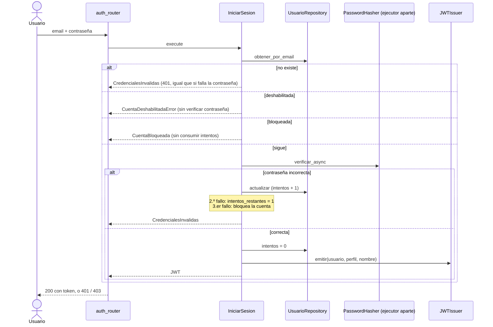
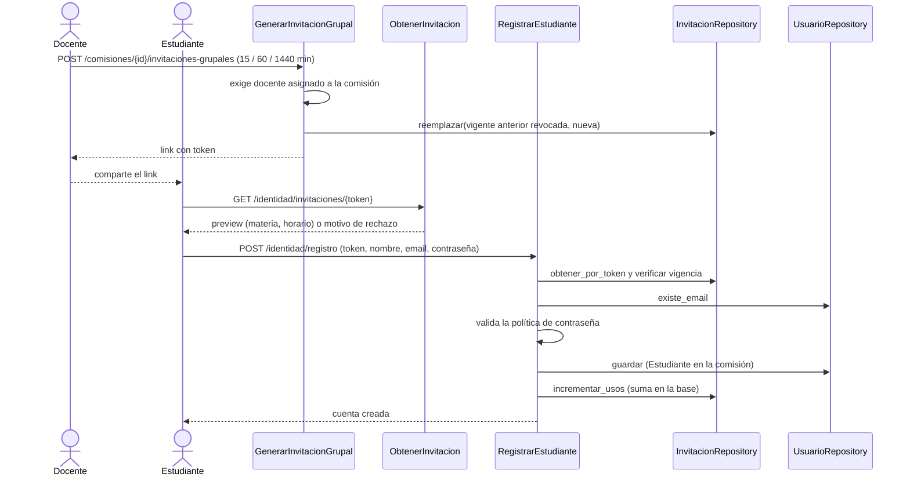
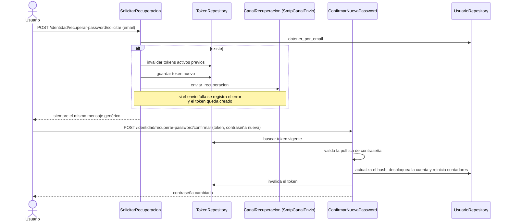
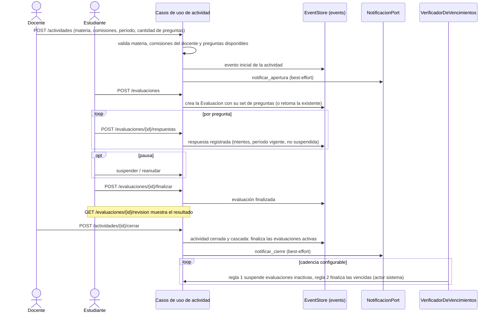
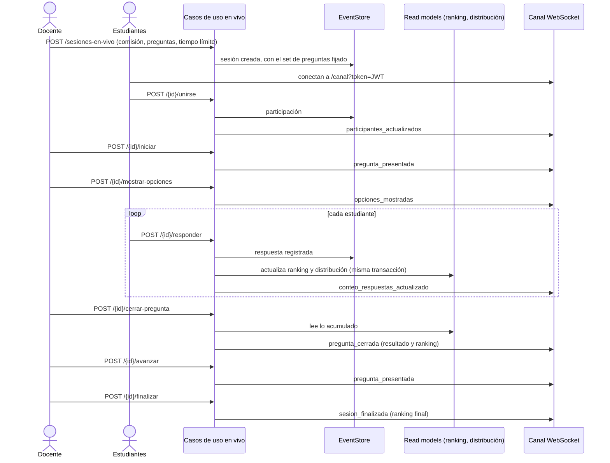

# 30 Interacciones en tiempo de ejecución (vista dinámica)

> Vista contrastada con el código de la versión `1.0.0` (Incremento 10.1, Fase 3). Plantilla: `_plantilla-vista.md`.

## Propósito
Mostrar, de punta a punta, qué pasa en los casos críticos: quién llama a quién, qué se guarda y qué se transmite.

## Interesados
**Mantenedor** (seguir un flujo sin leer 70 casos de uso) y **materia** (secuencias reales de un sistema con Event Sourcing y tiempo real).

## Para leer esta vista
Cada flujo tiene un diagrama de secuencia, las reglas que lo gobiernan y los tests que lo prueban (features BDD en `tests/features/`). Los nombres de casos de uso son los de `src/<bc>/use_cases/`. Para la estructura de cada pieza ver `10` a `14-componentes-*.md`.

## Alcance
Seis flujos: login con bloqueo, registro por link grupal, recuperación de contraseña, actividad de período abierto, sesión en vivo y las reglas comunes de persistencia y concurrencia. No incluye flujos de administración de cuentas ni de carga del banco.

## Fuentes
Casos de uso de `src/identidad/use_cases/` y `src/actividad_evaluativa/use_cases/`, routers de cada BC, `docs/design/domain/BC-actividad-evaluativa-modelo.md`, `ADR-002`, `ADR-005`, `ADR-006`.

## Reglas comunes de los flujos de Actividad Evaluativa

1. **Se guarda el evento y recién después se publica.** El caso de uso persiste el evento (y, en el modo en vivo, los read models) en la misma transacción y después avisa por el canal o por Notificaciones. Si el aviso falla, no se revierte lo guardado: el canal y el correo son *best-effort*.
2. **Concurrencia optimista.** La tabla `events` tiene la restricción única `uq_events_stream_sequence` sobre `(aggregate_type, aggregate_id, sequence_number)`. Dos comandos simultáneos sobre el mismo agregado: gana uno y el otro recibe `ConcurrenciaOptimistaError`, que el caso de uso traduce a un error de dominio (por ejemplo, `OpcionesYaMostradas`, `PreguntaActualNoCerrada`, `SesionYaFinalizada`).
3. **Autorización por comisión.** Los comandos del docente exigen que esté asignado a la comisión de la sesión o de la actividad (`ComisionNoAutorizada`, 403); el administrador no tiene chequeo.
4. **Idempotencia donde importa.** Iniciar una evaluación existente la retoma; unirse a una sesión ya unida devuelve la participación existente.

---

## Flujo 1 — Login con bloqueo de cuenta

`POST /api/identidad/login` → `IniciarSesionUseCase`.

- El mismo `401` para "no existe" y "contraseña incorrecta": no se revela si la cuenta existe (`US-1.1.4`).
- **Bloqueo:** al 3.er fallo consecutivo. Es permanente, salvo para el último administrador operativo, que queda bloqueado solo `15 minutos` por defecto (`duracion_bloqueo_temporal` configurable) para que el sistema no quede sin quien lo opere. Un bloqueo temporal responde `403` con `codigo: cuenta_bloqueada_temporal` y los segundos que faltan.
- Una cuenta bloqueada se desbloquea al confirmar una recuperación de contraseña (Flujo 3) o por acción del administrador.
- El hash corre en un ejecutor propio para que 30 logins simultáneos no bloqueen el event loop (`US-ADJ-63`).

**Tests:** `tests/features/inc2/US-2.2.1-bloqueo-cuenta-login.feature`, `inc2/US-2.2.9-login-cuenta-bloqueada.feature`, `inc9/US-ADJ-69-aviso-ultimo-intento.feature`, `tests/integration/inc9/test_us_adj_63_login_no_bloquea_integration.py`.

---

## Flujo 2 — Registro de estudiantes por link grupal

- Un solo link grupal vigente por comisión: generar otro revoca el anterior (`ADR-027`).
- El link se puede usar varias veces hasta que vence (15 min, 1 h o 1 día) o se revoca; el contador de usos se suma **en la base**, porque varios estudiantes se registran a la vez.
- Un registro rechazado (email repetido, contraseña débil) **no suma uso**.
- Errores del registro con `detail.codigo`: invitación inválida, vencida, revocada o ya usada (la individual), email ya registrado, contraseña corta o sin complejidad.
- El token no se imprime en el log de acceso (`/invitaciones/***`, `US-ADJ-68`).

**Tests:** `tests/features/inc9/US-ADJ-67-link-grupal.feature`, `tests/integration/inc9/test_us_adj_67_link_grupal_integration.py`, `tests/features/inc1/US-1.1.2-registro-estudiante.feature`, `tests/features/inc6-adj/US-ADJ-08-invitacion-preview.feature`.

---

## Flujo 3 — Recuperación de contraseña

- La solicitud no revela si el email existe (`INV-ID-17`); un solo token activo por usuario (`INV-ID-12`).
- Confirmar **desbloquea la cuenta** y reinicia los contadores (`US-ADJ-62`), pero no reactiva una cuenta deshabilitada.
- Con `EMAIL_MODO=consola` el link queda en el log en lugar de enviarse (instalación local).

**Tests:** `tests/features/inc5-adj/US-ADJ-38-solicitar-recuperacion-password.feature`, `US-ADJ-39-confirmar-recuperacion-password.feature`.

---

## Flujo 4 — Actividad de período abierto

- La actividad y cada evaluación son **flujos de eventos** en `events`; no hay filas por agregado (`24c`).
- `POST /evaluaciones` es idempotente: si ya hay una `EnCurso`, la devuelve; una invocación simultánea que pierde la carrera recibe la ganadora (`US-ADJ-11`).
- Finalizar siempre es posible, incluso con el período vencido; registrar una respuesta fuera de período no (`FueraDePeriodo`).
- Un fallo de correo no afecta la respuesta de crear ni de cerrar (`US-5.1.2`, `US-5.1.3`).
- El `VerificadorDeVencimientos` es seguro de reejecutar: los errores por estado ya cambiado se ignoran cuando el actor es `sistema`.

**Tests:** `tests/features/inc3/` (`US-3.1.2`, `US-3.1.3`, `US-3.2.2`, `US-3.2.3`, `US-3.2.4`, `US-3.3.2`) y `tests/features/inc5/US-5.1.3-notificacion-cierre-actividad.feature`.

---

## Flujo 5 — Sesión en vivo

- El set de preguntas se **fija al crear** la sesión: todos reciben el mismo (RF-08). Se puede cancelar (`sesion_cancelada`) hasta finalizar.
- Iniciar exige al menos un participante (`SinParticipantes`). Se puede entrar con la sesión ya iniciada (unión tardía), no con la finalizada.
- Responder valida: pregunta actual, opciones mostradas, pregunta no cerrada, tiempo y una sola respuesta por estudiante (el doble envío concurrente lo resuelve el chequeo optimista).
- **El ranking se actualiza al responder**, en la misma transacción que el evento; cerrar la pregunta no calcula nada pesado, solo lee lo acumulado (rendimiento con 60 estudiantes).
- Puntaje: `1000 × FactorTiempo × FactorDificultad × FactorImportancia` (0 si es incorrecta), ranking por suma simple (`puntaje_en_vivo.py`, spike de RF-10).
- El WebSocket autentica con el JWT en la URL y no chequea rol: docente y estudiante comparten el canal de lectura. Un handshake rechazado llega al navegador como cierre `1006`, no `1008`; el cliente consulta el estado por HTTP y, si recibe `401`, vuelve al login (`#605`).

**Tests:** `tests/features/inc6/` (`US-6.1.2` a `US-6.2.8`: crear, unirse, iniciar, mostrar opciones, responder, cerrar pregunta, avanzar, finalizar y consultar estado) y `tests/integration/inc6/test_canal_tiempo_real.py`.

---

## Decisiones reflejadas
`ADR-002` (event sourcing y CQRS), `ADR-005` (WebSocket), `ADR-006` (notificación directa), `ADR-007` y `ADR-014` (JWT y hash), `ADR-027` (link grupal).

## Restricciones y calidad
- Un proceso, sin broker: la difusión por WebSocket llega solo a las conexiones de ese proceso. Reiniciar la aplicación corta el canal; los clientes reconectan.
- Hasta 60 estudiantes simultáneos (RNF_v1): el diseño evita cálculo pesado en el cierre de la pregunta, pero la meta no se midió en esta versión.

## Cómo verificar esta vista contra el código
- Casos de uso: `src/identidad/use_cases/` y `src/actividad_evaluativa/use_cases/` (los docstrings de `execute` listan los errores de cada paso).
- Mensajes del canal: `grep -rn '"tipo"' src/actividad_evaluativa/use_cases/`.
- Restricción de concurrencia: `uq_events_stream_sequence` en `src/actividad_evaluativa/frameworks/db/models.py`.
- Cada flujo, con su feature en `tests/features/`.

## Cuándo hay que actualizarla
Un caso de uso nuevo en un flujo, un mensaje nuevo del canal, un cambio en la política de bloqueo o de invitaciones, o un canal nuevo de notificación.

## Sin verificar
- ⚠ Las secuencias se contrastaron con los docstrings y el código de los casos de uso y con la lista de features; no se ejecutaron en esta fase.
- ⚠ La duración del bloqueo temporal (15 minutos) es el valor por defecto del caso de uso; el valor configurado en una instalación puede diferir.
- ⚠ Flujos fuera de alcance, no documentados aquí: gestión de cuentas del administrador, carga del banco, autoregistro y analytics.
