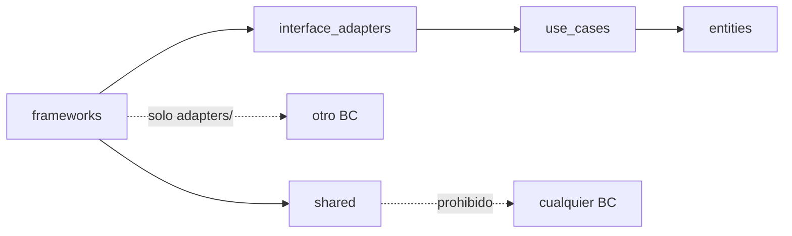
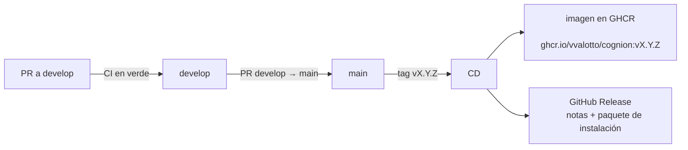

# 50 Vista de desarrollo

> Vista contrastada con el código de la versión `1.0.0` (Incremento 10.1, Fase 4). Plantilla: `_plantilla-vista.md`.

## Propósito
Explicar cómo está organizado el código y cómo llega un cambio a una versión publicada: estructura del repositorio, reglas de dependencias, controles de calidad, integración continua, entrega y versionado.

## Interesados
**Mantenedor** (dónde poner cada cosa y qué lo va a frenar), **materia** (un flujo de trabajo y una cadena de herramientas completos en un proyecto de una persona) e **instalador** (cómo se produce lo que descarga).

## Para leer esta vista
Hay tres cosas distintas: el **código** (`src/`, `frontend/`), la **evidencia** de calidad (`quality/`, `.cm/`) y la **cadena de entrega** (`.github/`, `scripts/`, `Dockerfile`). Los controles corren en tres momentos: al hacer commit, al hacer push y en el CI. El CD publica una versión recién cuando se crea un tag.

## Alcance
Estructura, dependencias, calidad y entrega. No incluye el proceso de planificación (US-IEDD, baselines), que está en `docs/plans/WORKFLOW-DESARROLLO.md` y `docs/plans/PLAN-CM.md`.

## Fuentes
`pyproject.toml`, `.pre-commit-config.yaml`, `.githooks/`, `.github/workflows/`, `scripts/`, `Dockerfile`, `CLAUDE.md`, `ADR-001`, `ADR-008`, `ADR-026`.

## 1. Estructura del repositorio

| Carpeta | Contenido |
|---|---|
| `src/<bc>/` | Un BC con 4 capas: `entities/`, `use_cases/`, `interface_adapters/`, `frameworks/` (`identidad`, `banco_preguntas`, `actividad_evaluativa`, `analytics`, `notificaciones`) |
| `src/shared/` | Lo transversal (JWT, base, SMTP, logging, salud, versión); `src/app.py` arma la API y `src/servidor.py` la sirve junto al frontend |
| `frontend/` | SPA React (Vite, TypeScript, Tailwind, shadcn/ui); `frontend/src/pages/`, `frontend/src/components/` y `frontend/src/lib/` (clientes de la API y sesión) |
| `migrations/` | Migraciones de Alembic (19) |
| `tests/` | `unit/`, `integration/`, `features/` (BDD en Gherkin) y `step_defs/`, `uat/`; cada uno organizado por incremento (`incN/`) |
| `deploy/` | `servidor/` (Linux con Docker) y `gcp/` (VM de prueba) |
| `scripts/` | `local/` (instalación sin Docker), `ci/` (alcance del CI), empaquetado de la Release y utilidades |
| `docs/` | Requerimientos, arquitectura, diseño, ADR, specs, planes, reportes y trazabilidad |
| `quality/reports/`, `.cm/baselines/` | Evidencia de calidad por US y por baseline |
| `.github/` | Workflows de CI, CD y smoke de la imagen; Dependabot |

## 2. Reglas de dependencias

`import-linter` (`uv run lint-imports`, 4 contratos en `[tool.importlinter]` de `pyproject.toml`) falla el CI si se rompe alguna:

1. **Capas dentro de cada BC:** una capa solo importa las internas. Excepción declarada: los repositorios de `interface_adapters/gateways/` importan los modelos ORM de `frameworks/db/models.py` de su mismo BC.
2. **Aislamiento entre BC:** solo `frameworks/adapters/` puede importar de otro BC.
3. **`shared` no importa de ningún BC.**
4. **`ADR-026`:** ningún BC salvo Analytics lee los modelos ORM de otro.

El detalle de cada cruce está en `20-context-map-integrations.md`.

## 3. Controles de calidad

| Momento | Control | Bloquea |
|---|---|---|
| **Commit** (`.githooks/pre-commit`) | `black`, `isort`, `ruff`, `mypy` sobre todo `src/`, `CodeGuard` | `mypy`, sí; `CodeGuard`, no (solo advierte) |
| **Push** (`.githooks/pre-push`) | `DesignReviewer` sobre `src/` con `--config pyproject.toml` | Sí, si hay CRITICAL (acoplamiento `max_cbo = 10`, `max_wmc = 25`, objetos Dios) |
| **CI** (`.github/workflows/ci.yml`) | `Lint backend` (ruff, mypy, import-linter), `Lint frontend` (oxlint, `tsc`, vitest), `Tests` (pytest con PostgreSQL 16), `DesignReviewer` | Sí: los cuatro son obligatorios en `develop` |
| **Cierre de baseline** | `ArchitectAnalyst` (siempre manual, `--config pyproject.toml`, con `coverage.json` generado antes), UAT y verificación en navegador | No bloquea el merge; informa tendencias |

Notas operativas:
- El hook de push **no se activa solo al clonar**: `git config core.hooksPath .githooks`.
- El único control que mide **acoplamiento** es `DesignReviewer`; un controlador o caso de uso cerca de `CBO = 10` puede fallar recién al hacer push.
- El "Zone of Pain" de `ArchitectAnalyst` es un falso positivo aceptado (`US-ADJ-13`/`19`); `LayerViolationsAnalyzer` no es confiable, por eso la regla de capas la hace cumplir `import-linter`.
- Los tests de integración y BDD **vacían la base** a la que apunte `DATABASE_URL`: usar siempre una base descartable, migrada a `head`.
- El umbral de cobertura (`fail_under`) está en `0`: la cobertura se mide y se informa, no se exige.

## 4. Integración continua

`ci.yml` corre en cada `push` a `develop` y en cada PR hacia `develop`. Un job inicial, **`Alcance del cambio`**, decide si el PR toca solo documentación que ningún test lee (`scripts/ci/alcance_cambio.sh`); en ese caso los cuatro checks obligatorios se saltean, y GitHub los cuenta como aprobados. Todo lo demás, y siempre un `push`, corre completo. La rama `develop` exige PR y que esté al día con la base (`strict`); el job `Tests` es el más largo (alrededor de 25 minutos).

`imagen-smoke.yml` construye la imagen y levanta `deploy/` solo cuando cambia algo que puede romperla (`Dockerfile`, `deploy/`, `pyproject.toml`, `uv.lock`), en ramas distintas de `develop` y `main`.

Dependabot propone actualizaciones semanales de `npm`, `pip` y GitHub Actions.

## 5. Entrega (CD)

- **`main` solo recibe `develop`** al cerrar un incremento (baseline). El push a `main` y el push de un tag disparan el CD.
- Con un tag `vX.Y.Z`: verifica que el tag coincida con `VERSION`, construye la imagen (dos etapas: frontend con Node 22 y runtime con Python 3.12), la publica en GHCR (pública, solo `x86_64`, sin `latest`) y crea la GitHub Release con las notas del `CHANGELOG` y el paquete `cognion-X.Y.Z-instalacion.tar.gz` (`scripts/extraer_notas.sh`, `scripts/empaquetar_release.sh`).
- Sin tag, el CD solo construye la imagen para comprobar que compila. **No despliega a ningún servidor**: instalar o actualizar es una acción del operador (`60-deployment-view.md`).

## 6. Versionado

SemVer. `VERSION` es la única fuente y debe coincidir con `pyproject.toml`, `frontend/package.json` y `uv.lock`; un test lo verifica. Cada baseline lleva un tag (`v1.0.0`) y un registro en `.cm/baselines/BL-NNN-*.md`. `CHANGELOG.md` alimenta las notas de la Release.

## 7. Ramas y cambios

`feature/US-N.M.K-…` y `feature/inc-N-…` (código), `fix/…` y `docs/…` salen de `develop` y vuelven por PR; Conventional Commits con alcance (`entities`, `use_cases`, `interface_adapters`, `frameworks`, `frontend`, `cm`, `tests`, `design`).

## Decisiones reflejadas
`ADR-001` (monolito modular y Clean Architecture), `ADR-008` (GitHub Actions), `ADR-025` (imagen y despliegue de prueba), `ADR-026` (acoplamiento por datos).

## Restricciones y calidad
- Los cuatro controles de `develop` mantienen el mismo estándar en cada PR de código, y el cumplimiento de capas y aislamiento queda automatizado.
- El único desarrollador es una persona: los controles automáticos reemplazan la revisión cruzada.

## Cómo verificar esta vista contra el código
- Contratos: `[tool.importlinter]` en `pyproject.toml` y `tests/unit/inc9/test_guarda_arquitectura.py`.
- CI: `.github/workflows/ci.yml` y `scripts/ci/alcance_cambio.sh` (con `tests/unit/inc10/test_ci_alcance_cambio.py`).
- CD: `.github/workflows/cd.yml`.
- Hooks: `.githooks/` y `.pre-commit-config.yaml`.
- Protección de la rama: `gh api repos/vvalotto/cognion/branches/develop/protection`.

## Cuándo hay que actualizarla
Un job, control o herramienta nuevos; un contrato de `import-linter`; un cambio de rama protegida; o una variante nueva de entrega.

## Sin verificar
- ⚠ El stack de `CLAUDE.md` dice Python 3.11, pero el proyecto usa 3.12 (`.python-version`, `Dockerfile`, CI) y `pyproject.toml` pide `>=3.11`.
- ⚠ Los umbrales de `DesignReviewer` (`max_cbo = 10`, `max_wmc = 25`) se leyeron de `pyproject.toml`; no se volvieron a calibrar en esta fase.
- ⚠ El job `release` del CD corrió una sola vez (`v1.0.0`).
