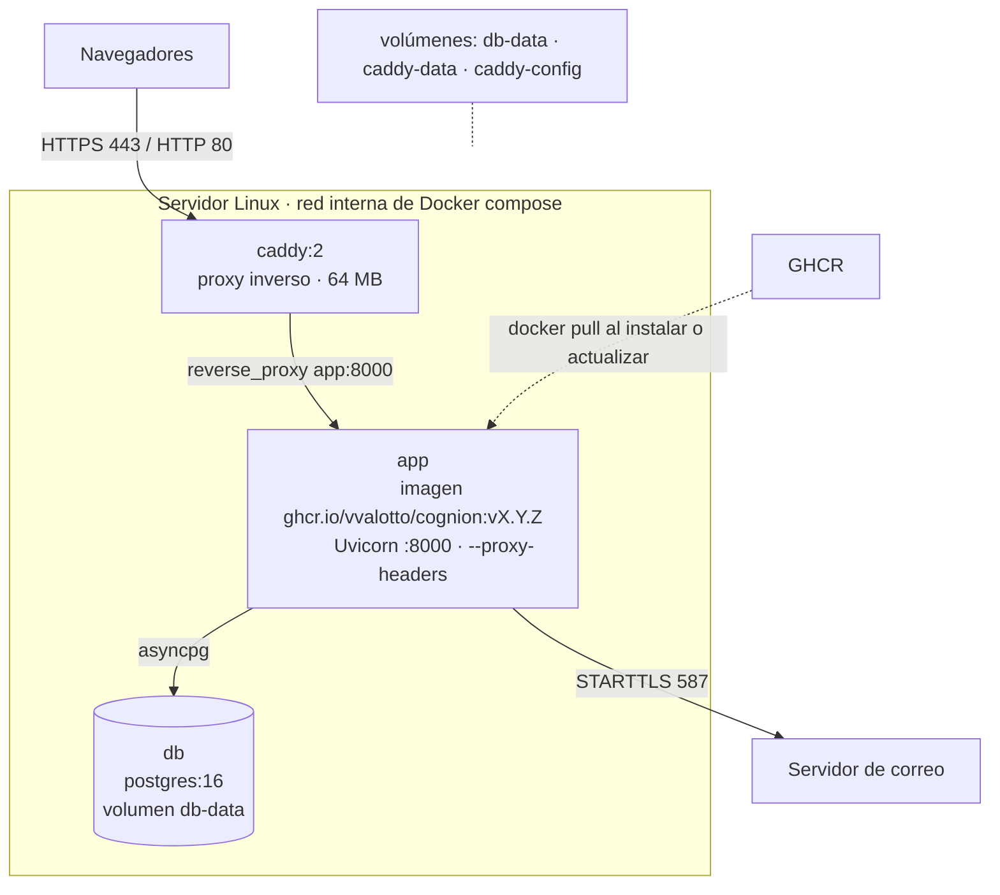
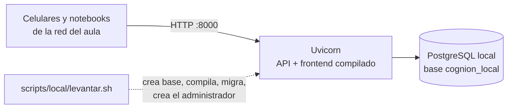

# 60 Vista de despliegue

> Vista contrastada con el código de la versión `1.0.0` (Incremento 10.1, Fase 4). Plantilla: `_plantilla-vista.md`. Los pasos de instalación están en `docs/INSTALACION.md`; esta vista explica la forma de cada instalación.

## Propósito
Mostrar dónde corre Cognión en cada variante de instalación, qué se publica a la red, cómo se actualiza y cómo se respalda.

## Interesados
**Instalador** (elegir y operar una variante), **mantenedor** (qué cambia entre variantes y qué se probó) y **materia** (una misma imagen y tres topologías).

## Para leer esta vista
La **aplicación es siempre la misma**: un proceso Uvicorn que sirve la API y el frontend (`02-container-view.md`). Lo que cambia es lo que la rodea: quién la arranca, si hay un proxy con HTTPS y dónde vive PostgreSQL. Cada variante tiene un estado de verificación propio (ver "Sin verificar"); leelo antes de elegir.

## Alcance
Topologías, red, ciclo de vida (instalar, actualizar, volver atrás, respaldar) y estado de cada variante. No incluye los pasos detallados (`docs/INSTALACION.md`) ni el costo de la nube (`ADR-025`).

## Fuentes
`deploy/servidor/`, `deploy/gcp/`, `scripts/local/`, `Dockerfile`, `docs/INSTALACION.md`, `docs/plans/DESPLIEGUE-LOCAL.md`, `docs/plans/DESPLIEGUE-GCP.md`, `ADR-018`, `022`, `024`, `025`.

## Las tres variantes

| | **A. Servidor Linux con Docker** | **B. Local, sin Docker** | **C. GCP (prueba)** |
|---|---|---|---|
| Cuándo | Uso estable con alumnos, servidor accesible por un dominio | Una clase en la red del aula, desde una sola máquina | Prueba de uso en una VM de nube |
| Dónde corre la aplicación | Contenedor `app` con la imagen de GHCR | Un proceso Uvicorn directo (`caffeinate` en macOS) | La misma composición de A, en una VM `e2-micro` |
| Proxy y HTTPS | Caddy (certificado automático) o HTTP sin dominio | Ninguno: HTTP directo | Caddy con un subdominio gratuito de DuckDNS |
| PostgreSQL | Contenedor `db` (`postgres:16`), volumen `db-data` | PostgreSQL instalado en la máquina, base `cognion_local` | Contenedor, igual que A |
| Puertos publicados | Solo Caddy (`80` y `443`, configurables) | La aplicación en `0.0.0.0:8000` (configurable) | Caddy `80` y `443` |
| Configuración | `deploy/servidor/.env` (lo genera `preparar-env.sh`; no está en el repo) | `.env.local` (lo crea `levantar.sh`) | `.env` de la VM |
| Entorno por defecto | `ENTORNO=local`, `EMAIL_MODO=consola` | `ENTORNO=local`, `EMAIL_MODO=consola` | `ENTORNO=local`, `EMAIL_MODO=consola` |
| Operación | `deploy/servidor/cognion.sh` | `scripts/local/levantar.sh`, `detener.sh`, `respaldar.sh`, `restaurar.sh` | `deploy/gcp/` (`aprovisionar.sh`, `desplegar.sh`, `destruir.sh`) |
| Estado de verificación | ⚠ Solo con `docker` simulado (Issue #624) | Instalación limpia ensayada en la Mac con la `1.0.0` | Verificada una vez y destruida el 2026-10-24 |

## Topología de A y C (Docker)

- **Solo Caddy publica puertos.** La aplicación (`8000`) y la base quedan en la red interna.
- Memoria: `COGNION_MEM_DB` y `COGNION_MEM_APP` (1 GB cada una por defecto; 64 MB para Caddy). En GCP la composición fija 300 MB para la base y 300 MB para la aplicación, por la VM de 1 GB.
- La base se configura con `max_connections=100`, porque cada operación abre su conexión (`NullPool`, `ADR-018`).
- La aplicación tiene `healthcheck` en `/api/health`; Caddy espera a que esté sana.
- Los registros salen por el driver `json-file` de Docker, con rotación (`10m` × 3).

## Topología de B (local)

- Un solo proceso en `0.0.0.0`; los alumnos entran por la IP de la máquina o su nombre `.local`. La red del aula puede aislar clientes y el firewall puede bloquear la entrada: son problemas de entorno, no de la aplicación.
- **Sin HTTPS:** las contraseñas viajan sin cifrar por la red local.
- El PID y el log quedan en `logs/local/`.

## Ciclo de vida

| Operación | A (servidor) | B (local) |
|---|---|---|
| **Instalar** | `preparar-env.sh <dominio>` o `--sin-dominio <host>`; `cognion.sh iniciar`; `cognion.sh administrador` | `uv sync`; `cp .env.example .env`; `levantar.sh --fondo` |
| **Migraciones** | `cognion.sh migrar` (paso explícito: la aplicación **nunca migra al arrancar**, `US-8.1.4`) | `levantar.sh` las aplica antes de arrancar |
| **Primer administrador** | `cognion.sh administrador` (contraseña sin eco) | `levantar.sh` lo pide o usa `ADMIN_*` |
| **Actualizar** | `cognion.sh desplegar <imagen>`: baja la imagen, **respalda** (si el respaldo falla no toca nada), migra con la imagen nueva mientras la vieja sigue sirviendo, reemplaza y espera la salud; si no responde, vuelve sola a la anterior | Detener, respaldar, descomprimir la versión nueva, `uv sync` y `levantar.sh --fondo` (reutiliza base y `.env.local`) |
| **Volver atrás** | `cognion.sh rollback`: solo la imagen; **las migraciones no se deshacen**. Si una migración dañó datos, restaurar el respaldo hecho antes | Restaurar el respaldo y volver a la versión anterior del código |
| **Respaldar** | `cognion.sh respaldar` | `scripts/local/respaldar.sh` |
| **Restaurar** | `cognion.sh restaurar <archivo>` (ensayo) o `--reemplazar` | `scripts/local/restaurar.sh <archivo>` (ensayo) o `--sobre-local` |
| **Detener** | `cognion.sh detener` (los datos quedan en el volumen) | `scripts/local/detener.sh` |

## Respaldo y restauración

- `pg_dump` en formato custom, **verificado** al terminar y acompañado de su `sha256`; se conservan los últimos 30 (`COGNION_RESPALDOS_N`). Carpeta: `./respaldos` en A y `~/CognionRespaldos` en B (`COGNION_RESPALDOS`).
- **Ensayo de restauración:** restaura en una base temporal, compara los conteos con la actual y la borra; no toca la base real.
- **Reemplazo:** exige escribir `RESTAURAR`, detiene la aplicación, restaura en una sola transacción y vuelve a levantarla; se pierde lo cargado después del respaldo.
- **El respaldo no sale del servidor solo.** Hay que copiarlo a otro equipo o disco, y programar el respaldo diario (por ejemplo con `cron`). `ADR-022` (pg_dump mensual a un Drive institucional) quedó como decisión de origen; lo implementado en la `1.0.0` es el respaldo local descripto arriba.

## Configuración que cambia entre instalaciones
- `FRONTEND_URL` y `CORS_ALLOWED_ORIGINS` deben coincidir con la dirección con la que se abre la aplicación (con puerto, si no es el estándar).
- **El link de invitación se arma con la dirección con la que el docente abrió la aplicación** (`window.location.origin`). Si entra por `localhost`, el link dirá `localhost` y no funcionará en los celulares de los alumnos: hay que abrir Cognión por el dominio, la IP o el nombre `.local` que ven los alumnos antes de generar el link.
- Con `ENTORNO=produccion` la aplicación exige SMTP real y no arranca en modo consola (`40-cross-cutting-concerns.md`). Todas las variantes se probaron con `ENTORNO=local`.

## Decisiones reflejadas
`ADR-018` (`NullPool`), `ADR-022` (respaldo), `ADR-024` (dominio y acceso), `ADR-025` (despliegue de prueba en GCP). **No hay un ADR para la variante A** (servidor Linux con Docker de la `1.0.0`): `ADR-021` y `ADR-024` hablan de Fly.io y siguen "En revisión".

## Restricciones y calidad
- **Continuidad** (`RNF_v1.md`): reiniciar la aplicación corta los WebSockets de una sesión en vivo; los clientes reconectan.
- **Diagnóstico:** `cognion.sh estado` consulta `/api/health` y `/api/health/ready`; `cognion.sh logs [servicio]` sigue el registro.
- **Seguridad de red:** solo el proxy está expuesto en A y C; B expone la aplicación entera por HTTP en la red local.

## Cómo verificar esta vista contra el código
- Servicios, puertos y límites de memoria: `deploy/servidor/docker-compose.yml` (y `deploy/gcp/docker-compose.yml`).
- Proxy: `deploy/servidor/Caddyfile`.
- Comandos y su comportamiento: la cabecera de `deploy/servidor/cognion.sh`, `respaldar.sh` y `restaurar.sh`.
- Instalación local: `scripts/local/levantar.sh`.
- Pruebas de estas piezas: `tests/unit/inc8/` y `tests/unit/inc10/` (con `docker` y `curl` simulados).

## Cuándo hay que actualizarla
Un servicio o puerto nuevo en la composición, una variante de instalación nueva (otro proxy, una nube distinta), un cambio en el respaldo o en la actualización, o un ADR de despliegue nuevo.

## Sin verificar
- ⚠ **Variante A (servidor Linux con Docker):** probada con un `docker` y un `curl` simulados, **no contra Docker real** (Issue #624). Es la variante recomendada para el uso estable.
- ⚠ **Variante C (GCP):** se verificó una vez y la VM se destruyó el 2026-10-24; no se repitió con la `1.0.0`.
- ⚠ **Variante B:** se ensayó una instalación limpia con la `1.0.0`, pero por HTTP y no en un navegador ni en un celular real; la actualización se simuló cambiando `VERSION` en la misma carpeta.
- ⚠ **`ENTORNO=produccion`:** ninguna variante se probó con SMTP real de producción.
- ⚠ **Capacidad:** no se midió la memoria de la composición Docker ni las conexiones a la base con 60 estudiantes reales (`max_connections=100` es una estimación). El tiempo de cierre de pregunta con 60 conexiones simuladas sí se midió, en una Mac (`US-6.2.9`).
